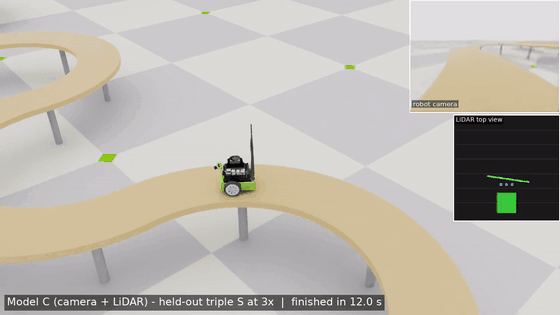
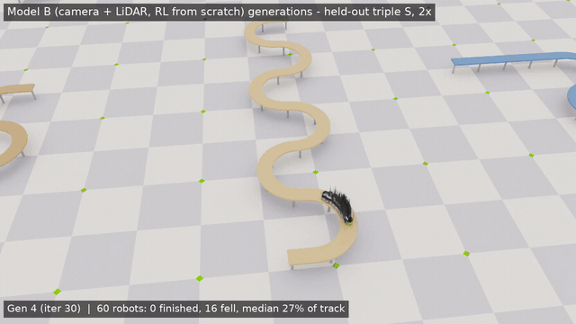
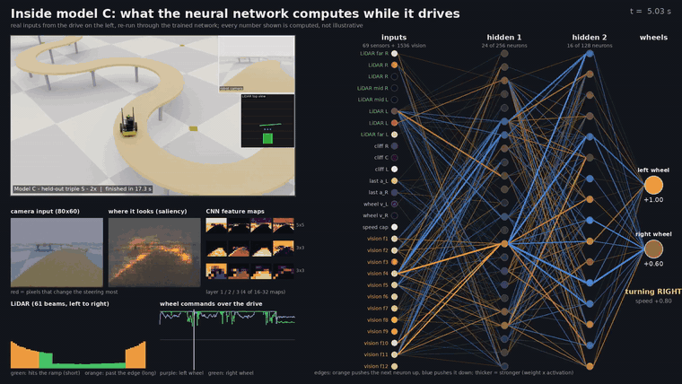
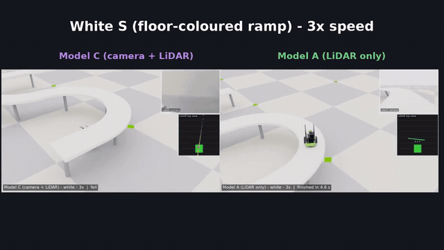
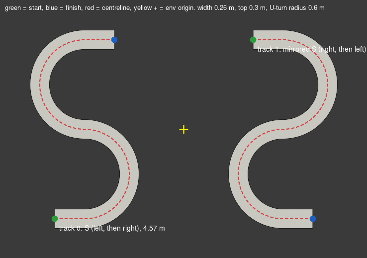

# Jetbot ramp RL: teaching a small robot to drive elevated ramps

Reinforcement learning in **NVIDIA Isaac Lab 3.0 / Isaac Sim 6.2**: a Jetbot learns to drive along elevated ramps
without falling off, first on one S-shaped ramp, then on randomly generated tracks it has never seen, at up to
~1 m/s, using a camera, a tilted 2D LiDAR and cliff sensors. Everything was trained on one RTX 5070.

| Teacher-distilled camera + LiDAR model on a never-seen track (3×) | 60 robots per checkpoint: watching a generation learn |
|---|---|
|  |  |



*The trained network re-run on a real drive: inputs → hidden neurons (orange pushes up, blue down) → two wheel speeds.*

## Downloads

All videos (34), the slide deck (66 slides, every video embedded) and the trained models are attached to the
**[v1.0 release](../../releases/tag/v1.0)**: they are too large for the repository itself.

## Results in one table (8 never-seen test tracks × 8 robots)

| Model | How it learns | Sensors | 1× | 3× (~1 m/s) |
|---|---|---|---|---|
| Teacher | PPO | exact track geometry (privileged) | 75% | 88% |
| A | PPO from scratch | LiDAR + cliff + proprio | 88% | 100% |
| B | PPO from scratch | camera + LiDAR | 88% | 98% |
| **C** | **teacher → distillation → PPO fine-tune** | **camera + LiDAR** | **100%** | **100%** |

On 8 deliberately hard *stress* tracks (133 m long, floor-coloured, rainbow-striped, hairpins, sharp corners,
18 cm wide) the picture flips: the LiDAR-only model A finishes 98% of runs, camera-heavy C 59%. Length is no
problem (C drove 133 m without falling); appearance changes are.



## Quick start

Requires Isaac Sim 6.2 and Isaac Lab 3.0 (Linux, NVIDIA GPU).

```bash
git clone <this repo> ~/jetbot_ramp && cd ~/jetbot_ramp
./install.sh                     # pip install -e into Isaac Sim's python; tasks register via the isaaclab.tasks entry point
# train (examples)
./run.sh ~/IsaacLab/scripts/reinforcement_learning/train.py --task Isaac-JetbotTracks-Teacher --num_envs 2048
./run.sh ~/IsaacLab/scripts/reinforcement_learning/train.py --task Isaac-JetbotTracks-Lidar --num_envs 2048
# evaluate a checkpoint on the held-out tracks
./run.sh tools/evaluate.py --task Isaac-JetbotTracks-Eval --agent lidar_cfg_entry_point --ckpt <model.pt> --speed 3 --out eval.json
```

`run.sh` strips conda from the environment and runs Isaac Sim's python. Offline tests (no simulator):
`~/isaacsim/kit/python/bin/python3 tests/test_ramp.py` and `tests/test_tracks.py`.

## Repository map

```
jetbot_ramp/        Isaac Lab task package: tracks, envs, agents (rsl_rl PPO / distillation configs)
tools/              smoke tests, evaluation, swarm / tour / picture-in-picture video tools, network animation
tests/              offline geometry tests
deck/               slide-deck builder (pptxgenjs)
docs/media/         README images and GIFs
export/             phase-1 camera student exported to ONNX
```

---

# Detailed notes

## Phase 1: one S-ramp

A Jetbot with a front camera learns to drive along an elevated S-shaped ramp in Isaac Lab 3.0 / Isaac Sim 6.2.
It is rewarded for progress along the ramp and penalised for falling off.

There are two training stages:

1. **Teacher (PPO, state only)**: sees exact track information (offset from the centre, heading
   error, upcoming centreline points). It trains fast on 1024 parallel envs with no rendering.
2. **Student (distillation, camera)**: a CNN that sees only the camera image (2 stacked frames)
   plus its last action. It learns to copy the teacher while driving itself (DAgger-style), so it
   also learns how to recover from its own mistakes. This camera-only policy is the one for the real Jetbot.



Each env has two tracks: an S and a mirrored S. Every reset picks one of them, so the policy has to
handle both turn orders (driving one S in reverse gives the same order, so it can't mirror itself).

## Layout

```
jetbot_ramp/
  __init__.py                  gym.register for the 4 tasks (imports only gymnasium)
  ramp.py                      S geometry, ramp USD writer, batched centreline projection (pure numpy/torch)
  jetbot_cfg.py                Jetbot ArticulationCfg (Isaac Sim 6.2 asset, velocity-driven wheels)
  jetbot_ramp_env_cfg.py       scene, rewards, termination, domain randomization, camera
  jetbot_ramp_env.py           DirectRLEnv implementation
  agents/rsl_rl_ppo_cfg.py           teacher PPO (MLP 128x128)
  agents/rsl_rl_distillation_cfg.py  CNN student + frozen teacher
tests/test_ramp.py             offline geometry/maths tests (no simulator)
tools/preview_ramp.py          top-down SVG of the tracks
tools/smoke_test.py            in-sim check with a scripted pure-pursuit driver
run.sh                         runs Isaac Sim's python with conda stripped from the environment
install.sh                     pip install -e into Isaac Sim's python (entry point "isaaclab.tasks")
```

| Task | Use |
|---|---|
| `Isaac-JetbotRamp-Teacher-Direct` | teacher PPO training (1024 envs, no camera) |
| `Isaac-JetbotRamp-Teacher-Direct-Play` | watch / record the teacher (16 envs) |
| `Isaac-JetbotRamp-Distill-Direct` | student distillation (128 envs, 80x60 RGB camera) |
| `Isaac-JetbotRamp-Distill-Direct-Play` | watch / record the student |

## MDP

- **Action**: left/right wheel speed in [-1, 1], scaled to ±12 rad/s (about 0.36 m/s). Policy runs at 30 Hz, physics at 120 Hz.
- **Teacher observation (20 values)**: lateral offset, sin/cos of heading error, 5 centreline points
  0.1-0.7 m ahead in the robot's frame, wheel speeds, base velocity, last action.
- **Student observation**: `camera` (6x60x80: 2 stacked RGB frames, mean removed) and `proprio` (last action).
  The stock Jetbot has no wheel encoders, so wheel speeds are off by default (`student_use_wheel_vel`).
- **Reward**:
  - +10 per metre of progress along the centreline
  - −20·lateral²·dt
  - −(1−cos heading error)·dt
  - −0.01·|Δaction|²
  - −10 for falling
  - +10 for finishing
- **Episode ends** when the robot falls below the ramp top, flips over, reaches the end, or after 30 s.
- **Resets**: random track (S or mirrored), 30% of resets start partway along the track, small offset and yaw noise.
- **Sim-to-real randomization** (`domain_randomization=True`):
  - wheel friction, chassis mass ±20%, motor strength ±30%
  - 0-2 steps of actuation latency, action noise
  - per-episode brightness, contrast and colour shift plus pixel noise on the camera image

## Status (2026-11-06)

Everything below ran on the RTX 5070.

| Phase | Result | Videos (`videos/`) |
|---|---|---|
| 1. Smoke tests | Scripted driver: 8/8 finish, 0 falls. Driving straight: every drive-off detected | `phase1_*` |
| 2. Teacher PPO | 1500 iters (~9 min, 1024 envs). 100% success, 0% falls, lap ~10.8 s. Solved by about iteration 40 | `phase2_*` |
| 3. Camera student | 600 iters (~15 min, 128 envs). 100% success, 0% falls, lap ~10.3 s, behaviour loss 0.0012 | `phase3_*` |

Changes made during the smoke tests:

- A wheel over the edge now counts as a fall (`edge_margin`), because the chassis can hang on the lip without dropping.
- The camera renders at 160x120 and is average-pooled to 80x60 (less RTX speckle).
- The ramp is plywood-coloured to contrast with the floor, and the dome light is dimmer.

Exported student (for the Jetson): `export/policy.onnx` (+ `.data`), with inputs `camera` [1,6,60,80]
(2 stacked RGB frames, each image's mean subtracted, range about -1..1) and `obs` [1,2] (last action); output `actions` [1,2]
(left/right wheel speed in [-1, 1], times 12 rad/s).

Single-robot videos with the robot-camera inset: `tools/record_policy.py` (uses `tools/pip_compose.sh`).

## Commands

Run everything from `~/jetbot_ramp` (logs go to `~/jetbot_ramp/logs/rsl_rl/...`). Isaac Lab 3.0 runs
headless by default and turns cameras on automatically. `--headless` and `--enable_cameras` were removed;
use `--viz kit` to open a viewer.

```bash
cd ~/jetbot_ramp

# 0. offline checks (CPU only, safe while another Isaac Sim session is running)
CUDA_VISIBLE_DEVICES= ~/isaacsim/kit/python/bin/python3 tests/test_ramp.py

# 1. register the tasks (editable install; nothing in ~/IsaacLab changes)
./install.sh

# 2. smoke tests (need the GPU; run when it's free)
./run.sh tools/smoke_test.py --task Isaac-JetbotRamp-Teacher-Direct --num_envs 8 --mode zero      # robots sit still on the ramp
./run.sh tools/smoke_test.py --task Isaac-JetbotRamp-Teacher-Direct --num_envs 8                  # scripted driver should finish
./run.sh tools/smoke_test.py --task Isaac-JetbotRamp-Distill-Direct --num_envs 4                  # also saves smoke_out/cam_*.png

# 3. teacher
./run.sh ~/IsaacLab/scripts/reinforcement_learning/train.py --task Isaac-JetbotRamp-Teacher-Direct
./run.sh ~/IsaacLab/scripts/reinforcement_learning/play.py --task Isaac-JetbotRamp-Teacher-Direct-Play --checkpoint latest --video

# 4. student: pass the teacher checkpoint (RSL-RL loads its actor into the frozen teacher)
./run.sh ~/IsaacLab/scripts/reinforcement_learning/train.py --task Isaac-JetbotRamp-Distill-Direct \
    --checkpoint logs/rsl_rl/jetbot_ramp_teacher/<run>/model_<iter>.pt
./run.sh ~/IsaacLab/scripts/reinforcement_learning/play.py --task Isaac-JetbotRamp-Distill-Direct-Play --checkpoint latest --video

# monitor
./run.sh -m tensorboard.main --logdir logs/rsl_rl
```

To watch progress, look for `Metrics/success_rate` going up and `Metrics/fall_rate` going down. For the
teacher, aim for success above 90%. The student should end up within about 10% of the teacher.

## Tuning

- If the turns are too hard, raise `TrackSpec.radius` or `width` in `ramp.py`. The USD regenerates automatically
  and is cached in `~/.cache/jetbot_ramp/`.
- If the student is too slow or runs out of memory, lower `num_envs` (`JetbotRampCameraEnvCfg`) or `num_steps_per_env`.
- If the policy is jittery, raise `rew_action_rate`.
- If the teacher stalls before the first U-turn, raise `random_start_prob` so it practises the turns more often.

## Sim-to-real (later)

- Set the camera `width`/`height`/FOV in `JetbotRampCameraSceneCfg` to match the real Jetbot camera. The stock
  IMX219 is about 160°, while the sim pinhole is about 115°. Ideally, train on undistorted crops of the real image.
- Build the physical ramp in the same colours you train with, or widen the colour randomization.
- Export the student to ONNX through Isaac Lab's export entrypoint (`isaaclab_rl.entrypoints.run_export_cli`)
  and run it on the Jetson with TensorRT at 30 Hz.


## Branch `feat/lidar-camera-fusion`: generalization, LiDAR + camera, 3x speed (2026-11-06)

Procedural tracks (12 train, 8 held-out test incl. triple S, long straight + S, tight S, narrow S), tilted 2D LiDAR
(analytic ray casting on a 1 cm ramp-top map + floor), 3 forward-down cliff sensors, camera, speed curriculum
1x -> 3x (36 rad/s, ~1 m/s), lap-time bonus. See `library_preview.png`.

| Model | Training | Robots | Wall time |
|---|---|---|---|
| Teacher | PPO on privileged track info | 2048 | ~9 min (stopped at iter 780, converged) |
| A | PPO from scratch: LiDAR + cliff + proprio | 2048 | ~45 min (3000 iters) |
| B | PPO from scratch: camera + LiDAR + cliff + proprio | 192 | ~58 min (1500 iters) |
| C | distill teacher -> same network as B (400 iters), then PPO fine-tune (500 iters) | 192 | ~17 + ~20 min |

Held-out test tracks (8 tracks x 8 robots, mean action, `tools/evaluate.py`; "falls" includes a wheel crossing the
edge margin):

| Model | Speed | Sensors | Success | Falls | Mean lap (finished) | Tracks not 100% |
|---|---|---|---|---|---|---|
| Teacher | 1x | normal | 75% | 25% | 20.0 s | tight_s, narrow_s |
| Teacher | 3x | normal | 88% | 12% | 6.2 s | narrow_s |
| A | 1x | normal | 88% | 12% | 18.2 s | narrow_s |
| A | 3x | normal | 100% | 0% | 6.1 s | - |
| A | 3x | LiDAR OFF | 0% | 100% | - | s_original, triple_s, long_straight_s, tight_s, narrow_s, rand_1001_00, rand_1001_01, rand_1001_02 |
| B | 1x | normal | 88% | 12% | 18.4 s | narrow_s |
| B | 3x | normal | 98% | 2% | 6.2 s | narrow_s |
| B | 3x | LiDAR OFF | 95% | 5% | 6.5 s | triple_s, long_straight_s |
| B | 3x | camera OFF | 100% | 0% | 6.6 s | - |
| C | 1x | normal | 100% | 0% | 17.8 s | - |
| C | 3x | normal | 100% | 0% | 6.2 s | - |
| C | 3x | LiDAR OFF | 91% | 9% | 6.2 s | narrow_s, rand_1001_02 |
| C | 3x | camera OFF | 55% | 45% | 7.2 s | s_original, triple_s, long_straight_s, tight_s, narrow_s, rand_1001_01 |

Takeaways: C is the best driver (100% at 1x and 3x); B is the most robust to a sensor failing (trained by RL with
sensor dropout it uses both); C leans on its camera (55% with camera off); A (LiDAR only) is excellent at 3x and
cheapest to train; the teacher generalizes worst (it relies on exact track coordinates, fails the narrow S).

Videos (`videos/fusion/`): `*_generations_long.mp4` (swarm of 60 robots per checkpoint, dense around the learning
jump), `teacher_test_mosaic.mp4`, `*_pip_*.mp4` (camera + LiDAR insets), `race_narrow_s_3x.mp4` (2x2 race).

Tools: `swarm.py` / `pip_replay.py` drive without a viewer (an active viewer changes camera-sensor renders) and
replay trajectories for the video; `progress_scan.py` picks generations; `evaluate.py`; `distill_to_ppo.py`.


## Stress test: 8 very difficult tracks (`STRESS_LIBRARY`, see `stress_preview.png`)

58 m wiggle, 133 m serpentine, white (floor-coloured) S, rainbow-striped S, 0.3 m hairpins, 90° near-sharp zigzag,
18 cm narrow S, 22 cm narrow chicane. Tasks `Isaac-JetbotTracks-Camera-Stress` / `Isaac-JetbotTracks-Stress`.
8 robots per track, deterministic (`tools/evaluate.py`):

| Track | C 1x | C 3x | B 3x | A 3x (LiDAR) |
|---|---|---|---|---|
| long_wiggle_60m | 8/8 | 8/8 | 8/8 | 8/8 |
| serpentine_120m | 8/8 | 8/8 | 8/8 | 8/8 |
| white_s | 0/8 | 1/8 | 0/8 | 8/8 |
| rainbow_s | 0/8 | 0/8 | 5/8 | 8/8 |
| hairpins_r03 | 8/8 | 6/8 | 7/8 | 8/8 |
| sharp_zigzag | 2/8 | 3/8 | 1/8 | 8/8 |
| narrow_18cm_s | 7/8 | 4/8 | 7/8 | 7/8 |
| narrow_chicane | 8/8 | 8/8 | 8/8 | 8/8 |
| **Overall** | **64%** | **59%** | **69%** | **98%** |

- Length is no problem: C drove 133 m and 58 m without a fall at both speeds (policies are purely reactive).
- Colour breaks the camera-heavy model: white and rainbow ramps 0-1/8 for C; A (colour-blind LiDAR) 8/8.
- Sharp corners hurt camera models too; A clears them. On these tracks A (98%) beats C (59%).

Videos: `videos/fusion/stress_tour_C_3x.mp4` (all 8 tracks, title cards + runs, `tools/track_tour.py`),
`stress_C_vs_A.mp4` and `stress_*_{A,C}.mp4` (side-by-side failures).

## Slide deck

`deck/build_deck.js` builds `Jetbot_Ramp_RL_Deck.pptx` (60 slides, all 30 videos embedded, ~127 MB) and, with `LITE=1`,
`Jetbot_Ramp_RL_Deck_lite.pptx` (480p videos, ~30 MB). Install once with `cd deck && npm install`, then
`NODE_PATH=$PWD/node_modules APPLY_THEME=<pptx skill>/scripts/apply_theme.js node build_deck.js`.


## Inside the network, and VLM / VLA explainer

- `tools/pip_replay.py --save_obs` records every network input and action of a drive.
- `tools/nn_activations.py` re-runs model C's network on that recording (outputs match the robot's actions to 1e-4) and
  saves layer activations, weight x activation contributions and a steering saliency map.
- `tools/nn_render.py` animates it next to the robot video -> `videos/fusion/nn_inside_model_C.mp4`.
- `tools/vla_explainer.py` renders a 60 s explainer: our vision->action policy vs a VLM vs a VLA ->
  `videos/fusion/vla_explainer.mp4` (VLM/VLA parts are conceptual; nothing of that kind was trained here).
