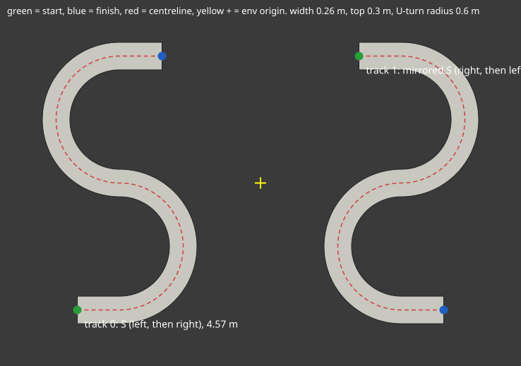

# jetbot_ramp

A Jetbot with a front camera learns to drive along an elevated S-shaped ramp in Isaac Lab 3.0 / Isaac Sim 6.2.
It is rewarded for progress along the ramp and penalised for falling off.

There are two training stages:

1. **Teacher (PPO, state only)**: sees exact track information (offset from the centre, heading
   error, upcoming centreline points). It trains fast on 1024 parallel envs with no rendering.
2. **Student (distillation, camera)**: a CNN that sees only the camera image (2 stacked frames)
   plus its last action. It learns to copy the teacher while driving itself (DAgger-style), so it
   also learns how to recover from its own mistakes. This camera-only policy is the one for the real Jetbot.



Each env has two tracks: an S and a mirrored S. Every reset picks one of them, so the policy has to
handle both turn orders (driving one S in reverse gives the same order, so it can't mirror itself).

## Layout

```
jetbot_ramp/
  __init__.py                  gym.register for the 4 tasks (imports only gymnasium)
  ramp.py                      S geometry, ramp USD writer, batched centreline projection (pure numpy/torch)
  jetbot_cfg.py                Jetbot ArticulationCfg (Isaac Sim 6.2 asset, velocity-driven wheels)
  jetbot_ramp_env_cfg.py       scene, rewards, termination, domain randomization, camera
  jetbot_ramp_env.py           DirectRLEnv implementation
  agents/rsl_rl_ppo_cfg.py           teacher PPO (MLP 128x128)
  agents/rsl_rl_distillation_cfg.py  CNN student + frozen teacher
tests/test_ramp.py             offline geometry/maths tests (no simulator)
tools/preview_ramp.py          top-down SVG of the tracks
tools/smoke_test.py            in-sim check with a scripted pure-pursuit driver
run.sh                         runs Isaac Sim's python with conda stripped from the environment
install.sh                     pip install -e into Isaac Sim's python (entry point "isaaclab.tasks")
```

| Task | Use |
|---|---|
| `Isaac-JetbotRamp-Teacher-Direct` | teacher PPO training (1024 envs, no camera) |
| `Isaac-JetbotRamp-Teacher-Direct-Play` | watch / record the teacher (16 envs) |
| `Isaac-JetbotRamp-Distill-Direct` | student distillation (128 envs, 80x60 RGB camera) |
| `Isaac-JetbotRamp-Distill-Direct-Play` | watch / record the student |

## MDP

- **Action**: left/right wheel speed in [-1, 1], scaled to ±12 rad/s (about 0.36 m/s). Policy runs at 30 Hz, physics at 120 Hz.
- **Teacher observation (20 values)**: lateral offset, sin/cos of heading error, 5 centreline points
  0.1-0.7 m ahead in the robot's frame, wheel speeds, base velocity, last action.
- **Student observation**: `camera` (6x60x80: 2 stacked RGB frames, mean removed) and `proprio` (last action).
  The stock Jetbot has no wheel encoders, so wheel speeds are off by default (`student_use_wheel_vel`).
- **Reward**:
  - +10 per metre of progress along the centreline
  - −20·lateral²·dt
  - −(1−cos heading error)·dt
  - −0.01·|Δaction|²
  - −10 for falling
  - +10 for finishing
- **Episode ends** when the robot falls below the ramp top, flips over, reaches the end, or after 30 s.
- **Resets**: random track (S or mirrored), 30% of resets start partway along the track, small offset and yaw noise.
- **Sim-to-real randomization** (`domain_randomization=True`):
  - wheel friction, chassis mass ±20%, motor strength ±30%
  - 0-2 steps of actuation latency, action noise
  - per-episode brightness, contrast and colour shift plus pixel noise on the camera image

## Status (2026-11-06)

Everything below ran on the RTX 5070.

| Phase | Result | Videos (`videos/`) |
|---|---|---|
| 1. Smoke tests | Scripted driver: 8/8 finish, 0 falls. Driving straight: every drive-off detected | `phase1_*` |
| 2. Teacher PPO | 1500 iters (~9 min, 1024 envs). 100% success, 0% falls, lap ~10.8 s. Solved by about iteration 40 | `phase2_*` |
| 3. Camera student | 600 iters (~15 min, 128 envs). 100% success, 0% falls, lap ~10.3 s, behaviour loss 0.0012 | `phase3_*` |

Changes made during the smoke tests:

- A wheel over the edge now counts as a fall (`edge_margin`), because the chassis can hang on the lip without dropping.
- The camera renders at 160x120 and is average-pooled to 80x60 (less RTX speckle).
- The ramp is plywood-coloured to contrast with the floor, and the dome light is dimmer.

Exported student (for the Jetson): `export/policy.onnx` (+ `.data`), with inputs `camera` [1,6,60,80]
(2 stacked RGB frames, each image's mean subtracted, range about -1..1) and `obs` [1,2] (last action); output `actions` [1,2]
(left/right wheel speed in [-1, 1], times 12 rad/s).

Single-robot videos with the robot-camera inset: `tools/record_policy.py` (uses `tools/pip_compose.sh`).

## Commands

Run everything from `~/jetbot_ramp` (logs go to `~/jetbot_ramp/logs/rsl_rl/...`). Isaac Lab 3.0 runs
headless by default and turns cameras on automatically. `--headless` and `--enable_cameras` were removed;
use `--viz kit` to open a viewer.

```bash
cd ~/jetbot_ramp

# 0. offline checks (CPU only, safe while another Isaac Sim session is running)
CUDA_VISIBLE_DEVICES= ~/isaacsim/kit/python/bin/python3 tests/test_ramp.py

# 1. register the tasks (editable install; nothing in ~/IsaacLab changes)
./install.sh

# 2. smoke tests (need the GPU; run when it's free)
./run.sh tools/smoke_test.py --task Isaac-JetbotRamp-Teacher-Direct --num_envs 8 --mode zero      # robots sit still on the ramp
./run.sh tools/smoke_test.py --task Isaac-JetbotRamp-Teacher-Direct --num_envs 8                  # scripted driver should finish
./run.sh tools/smoke_test.py --task Isaac-JetbotRamp-Distill-Direct --num_envs 4                  # also saves smoke_out/cam_*.png

# 3. teacher
./run.sh ~/IsaacLab/scripts/reinforcement_learning/train.py --task Isaac-JetbotRamp-Teacher-Direct
./run.sh ~/IsaacLab/scripts/reinforcement_learning/play.py --task Isaac-JetbotRamp-Teacher-Direct-Play --checkpoint latest --video

# 4. student: pass the teacher checkpoint (RSL-RL loads its actor into the frozen teacher)
./run.sh ~/IsaacLab/scripts/reinforcement_learning/train.py --task Isaac-JetbotRamp-Distill-Direct \
    --checkpoint logs/rsl_rl/jetbot_ramp_teacher/<run>/model_<iter>.pt
./run.sh ~/IsaacLab/scripts/reinforcement_learning/play.py --task Isaac-JetbotRamp-Distill-Direct-Play --checkpoint latest --video

# monitor
./run.sh -m tensorboard.main --logdir logs/rsl_rl
```

To watch progress, look for `Metrics/success_rate` going up and `Metrics/fall_rate` going down. For the
teacher, aim for success above 90%. The student should end up within about 10% of the teacher.

## Tuning

- If the turns are too hard, raise `TrackSpec.radius` or `width` in `ramp.py`. The USD regenerates automatically
  and is cached in `~/.cache/jetbot_ramp/`.
- If the student is too slow or runs out of memory, lower `num_envs` (`JetbotRampCameraEnvCfg`) or `num_steps_per_env`.
- If the policy is jittery, raise `rew_action_rate`.
- If the teacher stalls before the first U-turn, raise `random_start_prob` so it practises the turns more often.

## Sim-to-real (later)

- Set the camera `width`/`height`/FOV in `JetbotRampCameraSceneCfg` to match the real Jetbot camera. The stock
  IMX219 is about 160°, while the sim pinhole is about 115°. Ideally, train on undistorted crops of the real image.
- Build the physical ramp in the same colours you train with, or widen the colour randomization.
- Export the student to ONNX through Isaac Lab's export entrypoint (`isaaclab_rl.entrypoints.run_export_cli`)
  and run it on the Jetson with TensorRT at 30 Hz.
